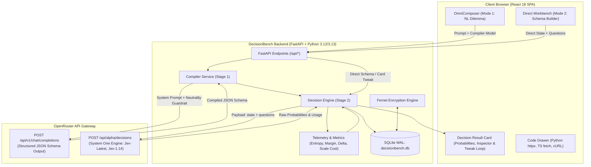
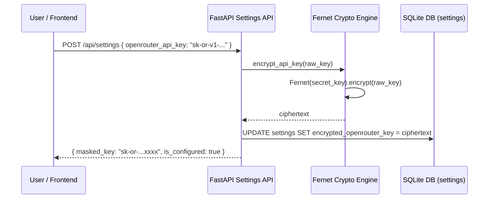

# System Architecture: DecisionBench

**System One Decision Workbench & NL-to-Decision Studio**

---

## 1. System Overview

DecisionBench provides a unified studio for interacting with structured decision AI models. It bridges the gap between messy natural-language dilemmas and rigid probability matrices through a two-stage compilation and execution architecture.



---

## 2. The Two-Stage Pipeline

### Stage 1: Natural-Language Schema Compiler (`/api/v1/chat/completions`)
When users submit conversational dilemmas, Stage 1 translates the dilemma into structured decision primitives without injecting bias.

- **Endpoint**: `POST https://openrouter.ai/api/v1/chat/completions`
- **Output Format**: Strict JSON Schema via `response_format: { type: "json_schema", ... }` with Pydantic validation fallback.
- **Default Models**:
  - `openrouter/free` (Free Models Router)
  - `inclusionai/ling-3.0-flash` (Ultra-low latency & cost)
  - `openai/gpt-6-luna` (Fast structured parser)
  - `xiaomi/mimo-v2.6-flash`, `deepseek/deepseek-v4.1-flash`
  - Any custom OpenRouter model slug.

#### The Criteria Neutrality Guardrail
System One decision models do not evaluate option keys (e.g. `"sqlite"`, `"postgres"`). They evaluate only the descriptive criteria text. If the parser creates an asymmetric description (e.g. praising option A while mentioning bugs in option B), it pre-determines the outcome.

The Stage-1 compiler prompt mandates:
1. **Fact & Constraint Extraction**: Consolidate all stated context, priorities, and environment details into `state`.
2. **Primitive Categorization**: Automatically classify dilemma sub-questions into `noul` (binary yes/no), `choice` (categorical 2–255), or `score` (ordinal rubric 2–10).
3. **Symmetrical Depth & Neutrality**: Every option description must have equal length, balanced strengths/weaknesses, and neutral factual language.

---

### Stage 2: System One Decisions API (`/api/alpha/decisions`)
System One models do not generate free-form tokens; they compute probability distributions over defined criteria.

- **Endpoint**: `POST https://openrouter.ai/api/alpha/decisions`
- **Headers**:
  - `Authorization: Bearer <OPENROUTER_API_KEY>`
  - `Content-Type: application/json`
  - `HTTP-Referer`: `http://localhost:8000`
  - `X-Title`: `DecisionBench`
- **Supported Models**:
  - `typesafe/jev-latest` (Default flagship)
  - `typesafe/jev-1.14`
  - `typesafe/jev-1.13`
  - `openai/gpt-6-luna-decisions`
  - `~perplexity/pplx-decider-latest`
  - `microsoft/microsoft-decision-1`
  - `inception/mercury-decide:free`

---

## 3. System One Primitives & Response Schemas

### 1. `noul` (Bernoulli / Binary Probability)
- **Request**:
  ```json
  {
    "type": "noul",
    "instructions": "Is it safe to package this application in a single container?",
    "criteria": {
      "true": "Single-container deployment is safe, reliable, and appropriate for the workload.",
      "false": "Single-container deployment risks data corruption or severe scaling bottlenecks."
    }
  }
  ```
- **Response**:
  ```json
  {
    "type": "noul",
    "noul": 0.94
  }
  ```
- **Semantics**: `noul` is a float in `[0.0, 1.0]` representing $P(\text{yes})$. Certainty is measured by distance from 0.50: $\text{Certainty} = 2 \cdot |P - 0.50|$.

### 2. `choice` (Categorical Selection, 2–255 options)
- **Request**:
  ```json
  {
    "type": "choice",
    "instructions": "Which database engine is best suited for this deployment?",
    "criteria": {
      "sqlite_wal": "Embedded single-file database with Write-Ahead Logging; zero external container dependencies.",
      "postgresql": "Client-server relational database requiring a dedicated container process; advanced indexing."
    }
  }
  ```
- **Response**:
  ```json
  {
    "type": "choice",
    "choice": "sqlite_wal",
    "probabilities": {
      "sqlite_wal": 0.92,
      "postgresql": 0.08
    },
    "confidence": 0.84
  }
  ```
- **Semantics**: Returns the winning key, full distribution dictionary, and OpenRouter `confidence` metric.

### 3. `score` (Ordinal Rubric, 2–10 levels)
- **Request**:
  ```json
  {
    "type": "score",
    "instructions": "Rate the operational maintenance complexity of this setup.",
    "criteria": [
      "Low: Single container with embedded storage; zero manual administration.",
      "Medium: Multi-process setup requiring periodic schema or volume maintenance.",
      "High: Multi-container cluster requiring dedicated database upgrades and clustering."
    ]
  }
  ```
- **Response**:
  ```json
  {
    "type": "score",
    "score": 0.15,
    "legend": {
      "0": "Low...",
      "1": "Medium...",
      "2": "High..."
    },
    "probabilities": {
      "0": 0.88,
      "1": 0.10,
      "2": 0.02
    },
    "confidence": 0.85
  }
  ```
- **Semantics**: `score` is the probability-weighted expected value: $E[\text{score}] = \sum_{i=0}^{N-1} i \cdot P(i)$.

---

## 4. Derived Mathematical Metrics & Telemetry

DecisionBench enriches every response with key decision-theory metrics:

1. **Shannon Entropy ($H$)**:
   $$H = -\sum_{i=1}^K p_i \log_2(p_i)$$
   Measures uncertainty across the distribution. For a binary choice, $H = 1.0$ at a 50/50 toss-up, and $H = 0.0$ when certain.

2. **Normalized Entropy ($H_{\text{norm}}$) & Certainty**:
   $$H_{\text{norm}} = \frac{H}{\log_2(K)}, \quad \text{Certainty} = 1.0 - H_{\text{norm}}$$
   Normalizes uncertainty into $[0.0, 1.0]$ regardless of option count $K$.

3. **Top-2 Margin ($\Delta P$)**:
   $$\Delta P = P_{(1)} - P_{(2)}$$
   The probability difference between the winning option and the runner-up.

4. **Projected Scale Costs**:
   - $\text{Cost per 1k decisions} = \text{run\_cost\_usd} \times 1{,}000$
   - $\text{Cost per 1M decisions} = \text{run\_cost\_usd} \times 1{,}000{,}000$

5. **Live Tweak Delta Tracking**:
   When a user edits an option on an existing card and clicks "Re-Run Decision Model", the new run references `parent_run_id`. The backend calculates probability shifts for every key:
   $$\Delta_{\text{key}} = P_{\text{new}}(\text{key}) - P_{\text{parent}}(\text{key})$$
   Rendered in the UI with emerald/rose delta tags (e.g., `+14.2%`, `-8.5%`).

---

## 5. Security & SQLite Schema

### Fernet Credential Encryption Flow


### Database Tables (`aiosqlite`)
- **`settings`**:
  - `id INTEGER PRIMARY KEY CHECK (id = 1)`
  - `encrypted_openrouter_key TEXT`
  - `default_stage1_model TEXT NOT NULL DEFAULT 'openrouter/free'`
  - `default_stage2_model TEXT NOT NULL DEFAULT 'typesafe/jev-latest'`
  - `pinned_models_json TEXT`
  - `thresholds_json TEXT`
  - `updated_at TIMESTAMP`
- **`scenarios`**:
  - `id TEXT PRIMARY KEY` (UUID4)
  - `name TEXT NOT NULL`
  - `description TEXT`
  - `category TEXT`
  - `raw_prompt TEXT`
  - `state_mode TEXT CHECK (state_mode IN ('text', 'json'))`
  - `state_content TEXT`
  - `questions_json TEXT NOT NULL`
  - `thresholds_json TEXT`
  - `is_builtin BOOLEAN DEFAULT 0`
  - `created_at TIMESTAMP`
  - `updated_at TIMESTAMP`
- **`runs`**:
  - `id TEXT PRIMARY KEY` (UUID4)
  - `parent_run_id TEXT REFERENCES runs(id) ON DELETE SET NULL`
  - `scenario_id TEXT REFERENCES scenarios(id) ON DELETE SET NULL`
  - `mode TEXT CHECK (mode IN ('auto_compile', 'direct', 'sweep', 'comparison'))`
  - `raw_user_prompt TEXT`
  - `parser_model TEXT`
  - `parser_latency_ms INTEGER`
  - `parser_tokens_in INTEGER`
  - `parser_tokens_out INTEGER`
  - `parser_cost_usd REAL`
  - `openrouter_gen_id TEXT`
  - `decision_model_requested TEXT NOT NULL`
  - `decision_model_served TEXT`
  - `state_payload TEXT NOT NULL`
  - `questions_payload TEXT NOT NULL`
  - `answers_payload TEXT NOT NULL`
  - `metrics_payload TEXT`
  - `decision_input_tokens INTEGER`
  - `decision_output_tokens INTEGER`
  - `decision_cost_usd REAL`
  - `decision_latency_ms INTEGER`
  - `status TEXT CHECK (status IN ('success', 'failed'))`
  - `error_message TEXT`
  - `created_at TIMESTAMP`
