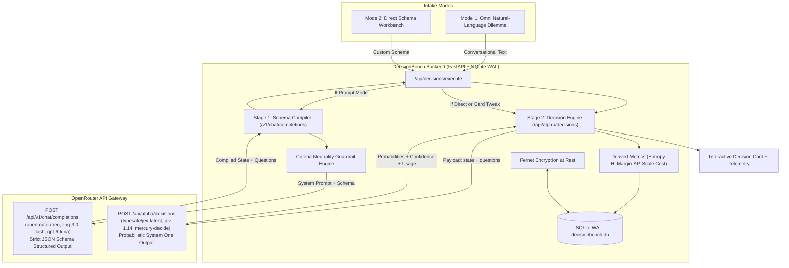

# DecisionBench

<div align="center">

**System One Decision Workbench & Natural-Language-to-Decision Studio**

*Interact with, visualize, fine-tune, and benchmark System One structured probabilistic AI models via OpenRouter's Decisions API.*

[](https://fastapi.tiangolo.com)
[](https://react.dev)
[](https://www.typescriptlang.org)
[](https://tailwindcss.com)
[](https://www.docker.com)
[](https://openrouter.ai)
[](https://www.truenas.com)

</div>

---

> [!IMPORTANT]
> ### 🤖 Project Attribution & AI Authorship Disclosure
> **This entire software application** — including the full-stack system architecture, the two-stage compiler pipeline, the FastAPI backend services, the React + TypeScript single-page application, the telemetry visualizers, the test suites, the Docker packaging, and the documentation — was **autonomously designed, implemented, and verified by [Google Antigravity](https://deepmind.google)**, with high-level conceptual direction and requirements provided by the repository owner.

---

## 🎯 What is DecisionBench?

Traditional LLMs sample tokens sequentially to produce free-form conversational text. In contrast, **System One AI models** (such as TypeSafe's **Jev** family) operate on a different paradigm: given an evaluated context (`state`) and a set of explicit questions, they evaluate **direct probability distributions** across structured decision primitives:
- **`noul`**: Bernoulli probability $P(\text{yes}) \in [0.0, 1.0]$ for binary gates and guardrails.
- **`choice`**: Categorical probability distributions across 2 to 255 mutually exclusive options.
- **`score`**: Probability-weighted expected values over ordered rubric levels ($0..N-1$).

These models run exclusively on OpenRouter's dedicated **Decisions API** (`POST https://openrouter.ai/api/alpha/decisions`).

**DecisionBench** bridges conversational dilemma intake with mathematical decision theory:
1. **Zero-Friction Prompt-to-Decision Studio**: Type any messy, multi-faceted dilemma in natural English. An ultra-low-cost or free Stage-1 parser LLM (`openrouter/free`, `inclusionai/ling-3.0-flash`, `openai/gpt-6-luna`) compiles your prompt into structured decision schemas with a strict **Criteria Neutrality Guardrail**.
2. **Anti-Bias "Tweak & Re-Run" Loop**: Inspect the exact criteria descriptions that the parser synthesized for each option. Tweak descriptions, add options, or adjust constraints directly on the decision card. Re-run Stage 2 directly in **~200ms** to see real-time probability shift deltas ($\Delta P$) without re-invoking the compiler.
3. **Precision Schema Workbench**: Build complex multi-question payloads from scratch with raw text or structured JSON state, interactive tri-state threshold sliders, and bulk-paste option generation.
4. **Dark Telemetry Studio**: Linear/Grafana-inspired dark UI with tabular numbers, continuous needle gauges, Shannon entropy readouts, split latency/token telemetry, and micro-dollar scale cost projections ($/1k and $/1M decisions).

---

## 🏗️ Architecture & Two-Stage Pipeline



---

## ⚡ Core Features

### 1. Criteria Neutrality Guardrail (CRITICAL)
> **Why this matters**: System One models **never see option keys** (like `"sqlite"` or `"postgres"`). They compute probabilities based 100% on the descriptive text inside `criteria` values.
If a compiler LLM writes a flattering description for one choice and a weak description for another, it pre-determines the decision. DecisionBench's Stage-1 prompt enforces:
- **Symmetrical depth**: Equal sentence length and technical detail for all options.
- **Objective framing**: Neutral factual language outlining trade-offs rather than subjective endorsements.
- **Context isolation**: Consolidating background parameters into `state` while keeping `criteria` focused on the specific alternatives.

### 2. Live Tweak & Re-Run Loop (Anti-Bias Tuning)
Every rendered Decision Result Card includes an inline **Extracted State & Options Inspector**:
- Edit the extracted `state` constraints on the fly.
- Rewrite any option's `criteria` description to remove perceived bias or test sensitivity.
- Click **+ Add Option** to inject a newly discovered alternative.
- Click **"Re-Run Decision Model (Bypass Parser)"** to send the updated schema straight to Jev (`/api/alpha/decisions`) in **~200ms**, displaying live probability shift deltas (`+14.2%` / `-8.5%`) against the parent run.

### 3. Precision Telemetry & Probability Visualizers
- **`noul` Visualizer**: Horizontal $0.000$ to $1.000$ gauge with a $0.50$ maximum-uncertainty tick mark, shaded zones matching your configured Tri-State Threshold Gate (`Reject <= 0.35`, `Review 0.35–0.75`, `Commit >= 0.75`), and a distance-from-50% certainty readout ($2 \cdot |P - 0.50|$).
- **`choice` Visualizer**: Ranked horizontal probability bars, winning option badge, Top-2 margin ($\Delta P = P_1 - P_2$), OpenRouter `confidence` metric, and normalized **Shannon Entropy** ($H$).
- **`score` Visualizer**: Continuous expected score value readout plotted as a precision needle on a scale bar, paired with a discrete probability distribution chart across levels $0..N-1$.
- **Split Telemetry Ribbon**: Never conflates Stage-1 LLM parsing overhead with Stage-2 System One decision speed. Tracks Stage 1 vs Stage 2 latency, tokens, micro-dollar cost, and projected scale costs ($/1k and $/1M decisions).

### 4. Drop-In Code & JSON Inspector Drawer
Generates production-ready, copy-pasteable code incorporating your exact compiled payload and configured threshold gate logic:
- **Python (`httpx`)**
- **TypeScript (`fetch`)**
- **cURL**
- **Compiled Request JSON** & **Raw Response JSON**

### 5. Multi-Model Benchmarking & Consistency
- **Side-by-Side Model Comparison**: Concurrently run the same decision schema across two different decision models (e.g., `typesafe/jev-latest` vs `openai/gpt-6-luna-decisions` or `inception/mercury-decide:free`) with automated divergence detection.
- **3x Consistency Sweep**: Automatically runs 3 consecutive evaluations to benchmark model variance and compute stability metrics.

### 6. Four Rich Built-In Scenario Presets
- 🏗️ **Hardware Architecture Dilemma**: Choosing database engine and container architecture under home server & TrueNAS constraints (`choice` + `noul` + `score`).
- 🛡️ **Agent Tool-Call Safety Gate**: Evaluating shell commands issued by autonomous agents before automated execution (`noul` + `score`).
- 🎟️ **Customer Support SLA Router**: Routing enterprise support escalations and determining immediate SLA refund eligibility (`choice` + `noul` + `score`).
- 🤖 **Account Signup Fraud & Bot Triage**: Evaluating structured JSON telemetry signals (IP reputation, ASN velocity, mouse entropy, headless fingerprint) for fraud prevention (`noul` + `choice`).

### 7. Self-Hosted Security & TrueNAS Native
- **Fernet Encryption at Rest**: OpenRouter API keys are encrypted at rest using `cryptography.fernet.Fernet` before storage in SQLite. The encryption key is sourced from `DECISIONBENCH_SECRET_KEY` or auto-generated at `/app/data/.secret_key` with strict `0600` file permissions.
- **Strict Key Masking**: Raw API keys are never stored in browser `localStorage` and never returned across the wire (`sk-or-...xxxx`).
- **SQLite Write-Ahead Logging (WAL)**: Single-folder backup (`/app/data`) with low write contention.
- **TrueNAS SCALE Compatibility**: Native `PUID` and `PGID` (`1000:1000`) privilege dropping via `gosu` in container entrypoint to prevent host-path dataset permission lockouts.

---

## 🤖 Supported Models

| Stage | Default Model | Additional Curated Options | Purpose |
|---|---|---|---|
| **Stage 1 (Compiler)** | `openrouter/free` *(Free Router)* | `inclusionai/ling-3.0-flash`<br>`openai/gpt-6-luna`<br>`xiaomi/mimo-v2.6-flash`<br>`deepseek/deepseek-v4.1-flash`<br>*(Any custom slug)* | Converts conversational text into structured decision schemas with balanced criteria. |
| **Stage 2 (Decider)** | `typesafe/jev-latest` *(Flagship)* | `typesafe/jev-1.14` *(Stable)*<br>`typesafe/jev-1.13` *(Legacy)*<br>`openai/gpt-6-luna-decisions`<br>`~perplexity/pplx-decider-latest`<br>`microsoft/microsoft-decision-1`<br>`inception/mercury-decide:free` | Evaluates probability distributions over typed `noul`, `choice`, and `score` criteria. |

---

## 🚀 Quickstart

### Option A: Docker Compose (Recommended)

1. Clone the repository:
   ```bash
   git clone https://github.com/yourusername/decisionbench.git
   cd decisionbench
   ```

2. Start the container:
   ```bash
   docker compose up -d
   ```

3. Open your browser at **`http://localhost:8000`**.
4. Click the **Key / Settings** badge in the top-right header to configure your OpenRouter API key (or pass `OPENROUTER_API_KEY` in `docker-compose.yml`).

---

### Option B: Local Development

#### Prerequisites
- **Python 3.12+** (tested through 3.13)
- **Node.js 20+** and **npm**
- An **OpenRouter API Key**

#### 1. Backend Setup
```bash
# In repository root:
python -m venv .venv

# On Linux/macOS:
source .venv/bin/activate
# On Windows PowerShell:
.\.venv\Scripts\Activate.ps1

cd backend
pip install -r requirements.txt

# Run backend development server (port 8000)
python -m uvicorn app.main:app --reload --port 8000
```

#### 2. Frontend Setup
```bash
# In a second terminal:
cd frontend
npm install
npm run dev
```
The frontend starts at **`http://localhost:5173`** with an automated proxy forwarding all `/api/*` calls to port `8000`.

---

### Option C: TrueNAS SCALE Custom App

DecisionBench is optimized for deployment on TrueNAS SCALE (Dragonfish / Electric Eel / Cobia).

1. In TrueNAS SCALE, create a ZFS dataset at `/mnt/tank/apps/decisionbench` with ownership set to `1000:1000`.
2. Launch a **Custom App** using the configuration detailed in **[`TRUENAS_SETUP.md`](TRUENAS_SETUP.md)**.
3. Persistent data, database files, and encrypted keys are stored safely on your ZFS pool, enabling instant, transaction-safe snapshots.

---

## ⚙️ Environment Variables

| Variable | Default | Description |
|---|---|---|
| `DATA_DIR` | `/app/data` *(container)* or `./data` *(local)* | Path where SQLite database and secret keys are stored. |
| `PUID` | `1000` | User ID for container privilege dropping (`gosu`). |
| `PGID` | `1000` | Group ID for container privilege dropping (`gosu`). |
| `OPENROUTER_API_KEY` | *(empty)* | Optional default OpenRouter API key. Can also be set in web UI. |
| `DECISIONBENCH_SECRET_KEY` | *(empty)* | Optional 32-byte URL-safe base64 Fernet key. Auto-generated if omitted. |
| `TZ` | `UTC` | Server timezone for timestamp logging. |

---

## 🧪 Testing & Verification

Run the comprehensive automated backend test suite:
```bash
pytest -v backend
```
*Covers SQLite WAL initialization, Fernet encryption/decryption roundtrips, strict key masking, Stage-1 compilation with neutral criteria synthesis, Stage-2 decisions execution, Shannon entropy math, live tweak delta tracking, and scenario CRUD.*

Build the frontend production bundle:
```bash
cd frontend
npm run build
```

---

## 📄 Project Artifacts

- **[`ARCHITECTURE.md`](ARCHITECTURE.md)**: In-depth technical architecture, SQLite schema, Fernet encryption flow, and decision-theory mathematical formulations.
- **[`PROJECT_STATE.md`](PROJECT_STATE.md)**: Live engineering status, Architecture Decision Records (ADR 1 to 5), and verification logs.
- **[`TASKS.md`](TASKS.md)**: Granular engineering checklist covering all development phases.
- **[`TRUENAS_SETUP.md`](TRUENAS_SETUP.md)**: Step-by-step TrueNAS SCALE Custom App deployment guide.

---

## ⚖️ License

MIT License. See [LICENSE](LICENSE) for details.
